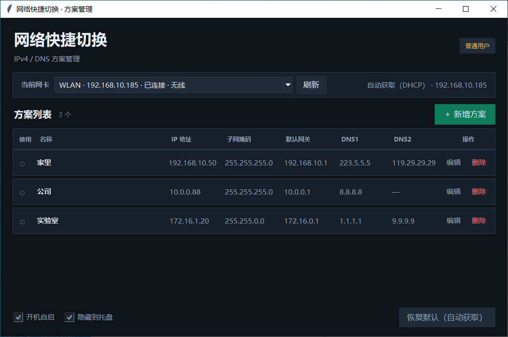
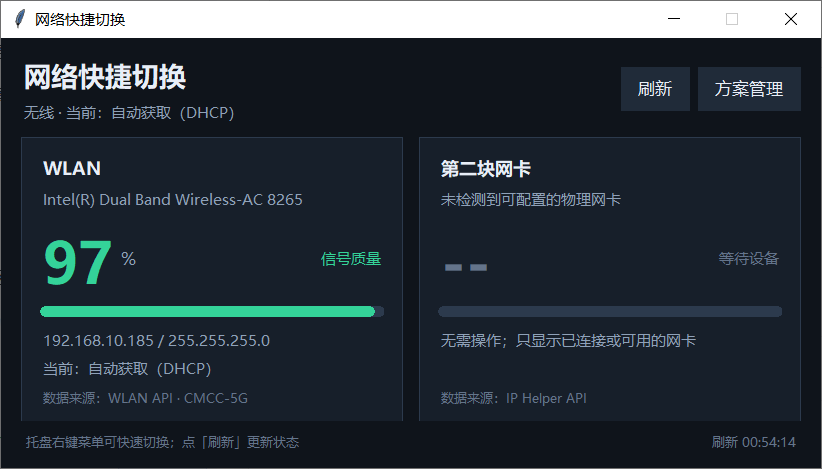

# 网络快捷切换 · Windows IPv4 / DNS 方案工具

一个 **零第三方依赖** 的 Windows 10/11 网络配置快速切换工具。只用 Python 标准库 +
`ctypes` 直接调用系统 DLL，GUI 使用 `tkinter`；没有 hidapi、pysystray、Pillow、pywin32。

它解决的事情很具体：把「家里 / 公司 / 实验室」这类 IPv4 配置保存成方案，点一下列表或
托盘菜单，就切换到「使用下面的 IP 地址」+「使用下面的 DNS 服务器地址」；一键恢复
「自动获得 IP 地址 / 自动获得 DNS 服务器地址」。






> 截图里的「家里 / 公司 / 实验室」是演示数据；首次运行默认没有方案。

---

## 1. 功能

### 主界面（方案管理）

- 列表列：**名称、IP 地址、子网掩码、默认网关、DNS1、DNS2**。
- 方案少于一屏时自动隐藏滚动条；只有方案超出可视区域时才允许滚动。
- 每行末尾有 **编辑**、**删除** 按钮。
- **点击任意一行**：该行打勾，并立即把该方案的 IP、掩码、网关、DNS1、DNS2 写入
  Windows 所选网卡的 IPv4 属性。**名称只属于本工具，不写入 Windows。**
- **新增方案**：打开新增对话框，名称、IP、掩码、网关、DNS1 必填，**DNS2 可留空**。
- **编辑**：复用同一个对话框；修改后保存到 `settings.json`。
- 新增/编辑对话框的每个输入框右侧都有 **× 清空按钮**，点击即可清空该字段。
- 网卡下拉框：选择要应用方案的以太网/Wi-Fi 网卡；会保存上次选择。
- 网络状态：启动时读取一次；之后点「刷新」或托盘「立即刷新」更新，**没有自动刷新**。
- 开机自启勾选框读取真实启动文件夹状态；只有用户点击时才写入。
- 「恢复默认（自动获取）」在主界面右下角，权限状态展示在右上角；底部「隐藏到托盘」勾选框控制关闭按钮：
  勾选时隐藏到托盘，取消勾选时直接退出。退出程序仍保留在托盘右键菜单。

### 简洁面板

- 固定两张网卡卡片：大号百分比、进度条、数据来源。
- Wi-Fi 优先显示 **WLAN API 信号质量 + SSID**；没有 WLAN 权限时退回 **链路可用 100%**，
  并在数据来源里明确写出「WLAN API 不可用」，不伪造信号。
- 以太网显示链路可用性；未连接显示灰色 `0`。
- 关闭面板 = 隐藏到托盘，不退出进程。

### 托盘常驻

- 单图标：优先加载 `assets/app.ico`，缺失时才退回 GDI 直接绘制。
- **左键**：打开简洁面板。
- **右键**：菜单包含
  - 打开主界面 / 打开简洁面板 / 立即刷新
  - 最多显示 10 个方案，**当前生效方案前面有对勾**
  - 方案超过 10 个时，末尾显示「更多方案…（共 N 个）」，点击跳转到主界面
  - 点击某个方案，执行与主界面点击行相同的应用逻辑
  - 最下面：**恢复默认（自动获取）**、**退出程序**
- 退出菜单会真正结束进程：删除托盘图标 → `PostQuitMessage` →
  销毁 Tk 根窗口 → 释放单实例互斥量。已验证不会留下僵尸进程。
- 单实例：重复启动不会开第二个托盘，只会把已有实例的主界面/面板叫出来。
- Windows 可能把新图标先放进「隐藏的图标」溢出区；右键任务栏 → 任务栏设置即可固定显示。

### 自定义图标

- 图标资源：`assets/app.ico`，包含 16/20/24/32/40/48/64/128/256 多尺寸；
  `assets/app-256.png` 是预览图。
- 设计：蓝色圆角底 + 两条反向白色箭头（快速切换）+ 绿色状态点。
- 生成脚本：`tools/make_icon.py`，只用标准库自己绘制 RGBA、做 4 倍超采样、
  写 PNG/ICO，**不需要 Pillow**。
- 使用位置：主窗口、简洁面板、方案对话框、托盘、桌面 `.lnk`、启动文件夹 `.lnk`。
- 任务管理器里的进程 exe 仍沿用 Python 的图标，因为 `网络快捷切换.exe` 是
  `pythonw.exe` 的硬链接；窗口、托盘和快捷方式已经是自定义图标。

### 低 CPU / 无自动轮询

- **没有自动刷新，也没有刷新定时器**。启动时读取一次，之后只在用户点「刷新」、
  托盘「立即刷新」或应用方案后读取。
- 读取网卡、WLAN、应用配置都在后台线程完成；Tk 主线程只处理 UI 和队列。
- 托盘空闲时几乎没有 CPU 占用；实测数据见文末「验证结果」。
- 100ms 的 Tk `after` 只是事件队列泵（把后台结果搬回 UI），不读网络、不 sleep 轮询。

---

## 2. 快速开始

```powershell
cd net-switch

python net_switch.py --manage     # 主界面（默认）
python net_switch.py --panel      # 简洁面板
python net_switch.py --tray       # 只驻留托盘

python net_switch.py --install    # 创建启动文件夹 .lnk + 桌面目录链接/桌面快捷方式
python net_switch.py --uninstall  # 删除启动项和桌面链接，保留项目与 settings.json
python net_switch.py --once       # 打印当前网卡、当前配置、方案，然后退出
python net_switch.py --quit       # 让正在运行的实例真正退出
python net_switch.py --debug      # 只在控制台输出诊断信息（不写日志文件）
python net_switch.py --version
```

### 建议启动方式

- 日常双击桌面「网络快捷切换」快捷方式（`.lnk`，指向项目内的 `启动.pyw`）。
- 开机自启使用「启动」文件夹里的 `网络快捷切换.lnk`，目标为
  `网络快捷切换.exe "…\net_switch.py" --tray`，**不会弹黑窗**，任务管理器进程名显示为
  「网络快捷切换」。
- 也可以手动：

```powershell
& "D:\Develop\Python\python\网络快捷切换.exe" .\net_switch.py --tray
```

---

## 3. 管理员权限与 UAC（重要）

Windows 修改 IPv4/DNS 必须管理员权限。本项目**不常驻管理员权限**，也不注册服务或
计划任务：

1. 平时以普通权限运行，界面常驻、读取网卡、显示托盘都正常。
2. 点方案/恢复默认时，用 `ShellExecuteExW(verb="runas")` 启动一个很小的
   `网络快捷切换.exe net_switch.py --elevated-apply <任务>` 子进程。
3. 子进程只执行 `netsh` / `Set-DnsClientServerAddress`，没有 GUI、没有黑窗、没有日志。
4. 父进程等待子进程结束后，**重新读取 `GetAdaptersAddresses` 的真实结果**再判断成功，
   不只相信退出码。
5. 用户取消 UAC → 网络配置完全不变，界面提示「已取消管理员授权」。

如果希望完全不弹 UAC，可以自行以管理员身份运行本工具（例如从管理员 PowerShell 启动
`网络快捷切换.exe net_switch.py --tray`）。**不建议**把启动项改成管理员计划任务，那会绕过
用户对每次网络改动的知情确认。

> ctypes 负责了网卡枚举、WLAN、托盘、`.ico` 图标、`.lnk` COM 和提权调用；
> 真正写 IPv4 时使用 Windows 自带的 `netsh` 与 PowerShell `Set-DnsClientServerAddress`。
> 这是 Windows 上稳定、可验证的配置入口，避免依赖未公开的 IP Helper 写接口。

---

## 4. 开机自启与桌面入口

### 启动文件夹快捷方式

`python net_switch.py --install` 会创建：

```
%APPDATA%\Microsoft\Windows\Start Menu\Programs\Startup\网络快捷切换.lnk
```

- 目标：`网络快捷切换.exe`
- 参数：`"<项目>\net_switch.py" --tray`
- 工作目录：项目目录
- 因此任务管理器 →「启动」标签里能看到「网络快捷切换」，任务管理器详细信息里的进程名
  也是「网络快捷切换」，可启用/禁用。
- 启用/禁用状态写入 Explorer 使用的
  `StartupApproved\StartupFolder\网络快捷切换.lnk`：
  - `02 00 …`：启用
  - `03 00 …`：禁用（仍保留 .lnk，任务管理器能再次启用）
- 主界面的勾选框**启动时只读真实状态**，不会自动纠正或重建启动项；只有用户点击时才写。

没有使用注册表 `Run`。

> 任务管理器里的进程名来自可执行文件名。`--install` 会在 Python 安装目录创建
> `网络快捷切换.exe`（优先硬链接到 `pythonw.exe`，同目录才能正常找到 Python DLL/标准库；
> 无权限时尝试复制）。如果该目录不可写，则退回 `pythonw.exe`，功能不受影响，但进程名仍是
> `pythonw.exe`。项目内的 `启动.pyw` 也会自动转交给 `网络快捷切换.exe` 启动。

### 桌面入口

| 桌面条目 | 类型 | 说明 |
|---|---|---|
| `网络快捷切换项目` | 目录链接 | 优先真符号链接；无权限时降级 `mklink /J` junction |
| `网络快捷切换.lnk` | 快捷方式 | 真正的 `.lnk`，指向项目内 `启动.pyw`，可跨盘使用 |

两者都**不会复制项目文件**。`启动.pyw` 只使用自身所在目录定位项目和
`net_switch.py`，不再写死安装时的绝对路径，因此整个项目文件夹可以复制到任意盘位
直接运行。移动项目后，重新运行一次 `--install` 刷新桌面和启动项快捷方式即可。

当前机器实测：

```
网络快捷切换项目  Junction
网络快捷切换.lnk  Shortcut
```

不再对桌面启动器做硬链接或符号链接。旧版本留下的桌面 `网络快捷切换.pyw`
硬链接会在下次 `--install` 时自动清理；它无法跨盘，是之前 WinError 17 的原因。

---

## 5. 配置与数据

配置文件：`settings.json`（配置，不是日志）。写入采用同目录临时文件 +
`os.replace`，不会留下半个 JSON：

```json
{
  "version": 1,
  "close_to_tray": true,
  "adapter_guid": "{F6F0BE9F-98BE-4F13-AF2E-E49D8A1FB54C}",
  "profiles": [
    {
      "id": "p_0123456789",
      "name": "家里",
      "ip": "192.168.1.50",
      "mask": "255.255.255.0",
      "gateway": "192.168.1.1",
      "dns1": "223.5.5.5",
      "dns2": "119.29.29.29"
    },
    {
      "id": "p_abcdef0123",
      "name": "公司",
      "ip": "10.0.0.88",
      "mask": "255.255.255.0",
      "gateway": "10.0.0.1",
      "dns1": "8.8.8.8",
      "dns2": ""
    }
  ]
}
```

- `DNS2` 允许空字符串；应用时只写入 DNS1，且会清除旧的第二 DNS。
- 子网掩码必须是连续掩码；网关默认要求与 IP 同子网。
- `adapter_guid` 记住上次选中的网卡。
- `close_to_tray` 记住主界面关闭按钮的行为：`true` 隐藏到托盘，`false` 直接退出。
- 不写任何日志文件；`--debug` 只输出到当前控制台。

---

## 6. 实现要点

### 网卡读取

`iphlpapi.dll!GetAdaptersAddresses`（`AF_INET` +
`GAA_FLAG_INCLUDE_PREFIX | GAA_FLAG_INCLUDE_GATEWAYS`）：

- `FriendlyName` / `Description` / `IfIndex` / GUID / MAC / 速率
- IPv4 地址、`OnLinkPrefixLength` 换算掩码、默认网关
- DNS 服务器列表
- DHCP 标志 `IP_ADAPTER_DHCP_ENABLED`、链路状态、网卡类型
- 静态 DNS 额外读取接口注册表 `NameServer`，用于判断「DHCP IP + 静态 DNS」这种混合状态

### Wi-Fi 信号

`wlanapi.dll`：`WlanOpenHandle` → `WlanEnumInterfaces` →
`WlanQueryInterface(wlan_intf_opcode_current_connection)`，读取
`wlanSignalQuality` 和 SSID。失败时安静回退到链路可用性，不影响主流程。

### 应用配置

静态 IP（`netsh`）：

```text
netsh interface ipv4 set address name="WLAN" static <ip> <mask> <gateway>
```

DNS 精确列表（PowerShell，避免旧 DNS2 残留）：

```powershell
Set-DnsClientServerAddress -InterfaceIndex <idx> -ServerAddresses @('dns1','dns2')
```

恢复默认：

```text
netsh interface ipv4 set address name="WLAN" source=dhcp
Set-DnsClientServerAddress -InterfaceIndex <idx> -ResetServerAddresses
```

PowerShell 不可用/失败时退回 `netsh` DNS 命令。

### 托盘与退出

- 隐藏窗口类 `NetSwitchTrayWindow_v1`，`Shell_NotifyIconW` NIM_ADD/MODIFY/DELETE。
- `TaskbarCreated` 消息处理 Explorer 重启。
- `WM_DESTROY`：`NIM_DELETE` → `PostQuitMessage(0)`。
- Tk 主线程退出时 `tray.stop()` 等 `_stopped`，再销毁 root、释放 mutex。
- `--quit` 通过 `PostMessage(WM_APP_QUIT)` 通知已有实例；进程退出后隐藏窗口和互斥量都消失。

---

## 7. 文件结构

```
net_switch.py              入口 / CLI / 提权子进程入口
netswitch/
  app.py                   应用控制器、手动刷新/应用线程
  config.py                Profile 数据模型、校验、settings.json 原子读写
  netinfo.py               GetAdaptersAddresses、网卡模型、方案匹配
  wlan.py                  WLAN API 信号质量
  netcfg.py                netsh/PowerShell 写入、UAC、结果校验
  tray.py                  隐藏 Win32 窗口、Shell_NotifyIcon、托盘菜单
  icons.py                 图标加载、Tk 窗口图标、GDI 托盘图标兜底
  manager.py               主界面 / 方案列表 / 行内编辑删除
  compact.py               简洁面板 / 两张网卡卡片
  dialogs.py               新增/编辑方案对话框
  ui_common.py             深色主题、按钮、进度条
  shortcuts.py             IShellLinkW .lnk、StartupApproved、目录链接
  installer.py             安装/卸载入口
  win32.py                 DLL、GUID、Known Folder、DPI、窗口居中、进程启动器
启动.pyw                    --install 生成的启动器（相对自身目录，可随项目移动）
<Python 目录>\网络快捷切换.exe  硬链接/副本到 pythonw.exe，提供任务管理器进程名
settings.json               配置（运行时生成；首次为空方案）
assets/app.ico              应用图标（16–256 多尺寸）
assets/app-256.png          图标预览图
tools/make_icon.py          纯标准库图标生成脚本
docs/                       截图
```

---

## 8. 已知的坑与处理

| 坑 | 处理 |
|---|---|
| 关闭托盘后进程变僵尸 | `WM_DESTROY` 删图标 + `PostQuitMessage`；主线程等托盘线程、销毁 Tk、释放 mutex |
| Tk 跨线程崩溃 | 后台线程只写 `queue.Queue`；Tk 主线程泵队列；不跨线程碰控件 |
| 空闲轮询费 CPU | 无自动刷新、无 sleep 轮询；读取只在启动、手动刷新、应用方案后发生 |
| `GetAdaptersAddresses` 不返回网关 | 必须加 `GAA_FLAG_INCLUDE_GATEWAYS` |
| `sockaddr` 取 IP 错位 | 转 `SOCKADDR_IN` 读 `sin_addr`，不能读 `sa_data[0:4]` |
| 只设置 DNS1 时旧 DNS2 残留 | 使用 `Set-DnsClientServerAddress -ServerAddresses` 精确列表，失败再 netsh 兜底 |
| DHCP IP + 静态 DNS 判断 | 读取接口注册表 `NameServer`，不能只看 DHCP 标志 |
| UAC 取消/失败被误报成功 | 子进程返回后父进程重新读取真实 IPv4/DNS 再判定 |
| 启动项被程序自动纠正 | 启动时只读；只有用户点勾选框才写 StartupApproved |
| 任务管理器禁用后仍勾选 | 读取 `StartupApproved\StartupFolder` 的 02/03 状态 |
| 高 DPI 字体/图标发虚 | 进程 Per-Monitor V2；Tk scaling；GDI 按 DPI 生成图标 |
| 窗口底部被裁 | 用 Win32 工作区物理像素居中并限制尺寸 |
| 桌面符号链接无权限 | 目录降级 junction；桌面启动入口改用 `.lnk`，不做文件链接 |
| 桌面和项目不在同一盘 | 不再硬链接 `启动.pyw`，避免 `os.link` 跨盘 WinError 17 |
| 项目移动后路径失效 | `启动.pyw` 用 `__file__` 定位自身；移动后重跑 `--install` 刷新快捷方式 |
| 任务管理器进程名显示 pythonw.exe | `--install` 在 Python 目录创建 `网络快捷切换.exe`（硬链接/副本）；桌面启动器自动转交 |
| `pythonw` 下看不到错误 | 不写日志；`--debug` 控制台模式排查；UI 用状态栏/对话框提示 |

---

## 9. 验证结果

本机：Windows 10 19044，Python 3.15.2，WLAN（Intel AC 8265）。

- `GetAdaptersAddresses` 正确读取 WLAN：`192.168.10.185 / 255.255.255.0 / 192.168.10.1 /
  192.168.10.1`，DHCP=true。
- WLAN API 读取到 `CMCC-5G`，信号质量 `97%`，简洁面板显示「信号质量 / WLAN API」。
- 主界面列表、行内编辑/删除、新增/编辑复用对话框、DNS2 空值校验、add → edit → delete
  全流程通过。
- 点击行会触发应用逻辑；勾选状态由当前 Windows 配置与方案精确比对生成。
- **真实写入测试通过**：把 WLAN 改为静态 `192.168.10.185 / 255.255.255.0 /
  192.168.10.1`，DNS `119.29.29.29`、`223.5.5.5`，父进程复核一致；随后恢复 DHCP，
  等待租约重新取得 `192.168.10.185` 和 DNS `192.168.10.1` 后才判定成功。
- 托盘图标创建成功；右键菜单显示「打开主界面 / 打开简洁面板 / 立即刷新 / 方案列表 /
  恢复默认（自动获取）/ 退出程序」；选中方案前显示对勾。
- 左键点击托盘图标打开简洁面板。
- 启动文件夹 `.lnk`：target=`网络快捷切换.exe`，args=`"…\net_switch.py" --tray`，
  `StartupApproved` 为启用，任务管理器可见，进程名为「网络快捷切换」。
- 桌面目录链接为 Junction；桌面 `网络快捷切换.lnk` 为真正快捷方式，指向项目内
  `启动.pyw`，不是副本，也不跨盘硬链接。
- 自定义图标：`assets/app.ico` 包含 9 个尺寸；主窗口和对话框已套用，
  桌面/启动项 `.lnk` 的 `icon_location` 指向该文件，托盘从同一 `.ico` 加载。
- 无自动刷新验证：启动后只保留 100ms 事件队列泵，没有刷新 `after` 回调；手动点「刷新」
  才重新读取。主界面底部只保留开机自启和「隐藏到托盘」勾选框，无刷新间隔输入框、
  状态行和退出按钮；「恢复默认」在右下角，权限状态展示在右上角。
- 关闭行为验证：勾选时关闭主窗口只隐藏、进程和托盘仍在；取消勾选后关闭主窗口会真正退出进程。
  该勾选状态保存在 `settings.json` 的 `close_to_tray`。
- `--quit` 后托盘窗口、隐藏窗口、进程均退出，未发现僵尸进程。
- 托盘空闲 65 秒 CPU 时间：**0.0156 秒**（`GetProcessTimes` 采样；期间无自动刷新）。
- 项目内没有日志文件；`--debug` 才输出控制台诊断。

> 真实写入测试使用的是用户指定的本机 WLAN 地址，测试完成后已恢复 DHCP。
> 在其他网络环境下切换前，请确认方案地址不会与现有网络冲突。

---

## 10. 卸载

```powershell
python net_switch.py --uninstall
```

删除：

- `%APPDATA%\…\Startup\网络快捷切换.lnk` 及 StartupApproved 值
- 桌面 `网络快捷切换项目` 链接
- 桌面 `网络快捷切换.lnk` 快捷方式（以及旧版 `网络快捷切换.pyw` 链接）

保留：

- 项目代码
- `settings.json`（方案不会丢）
- `启动.pyw`

如果需要彻底删除，再手动删除整个 `net-switch` 目录即可。
